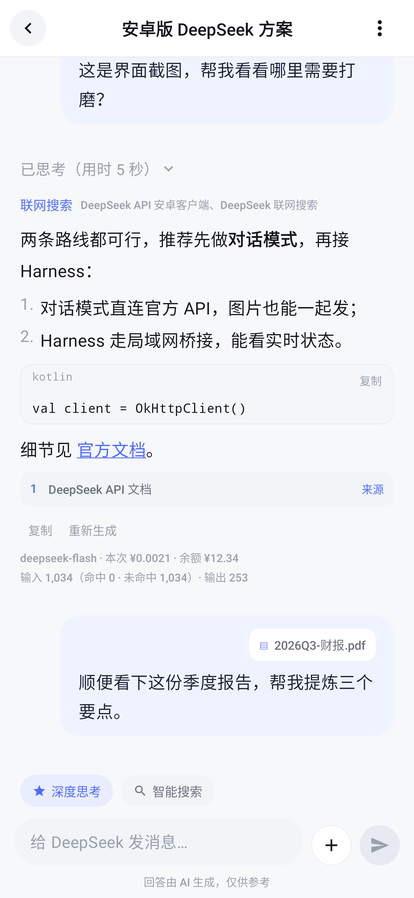
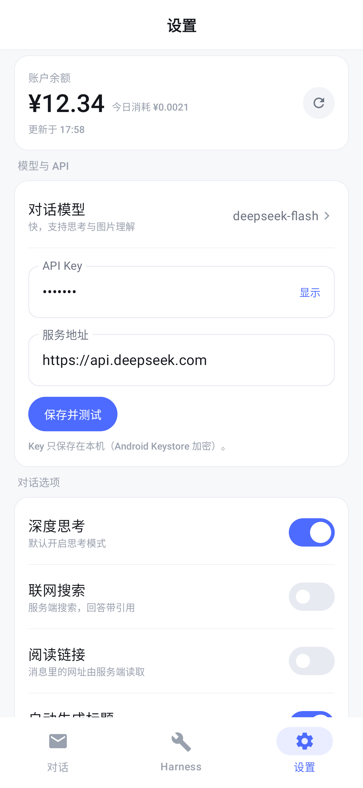
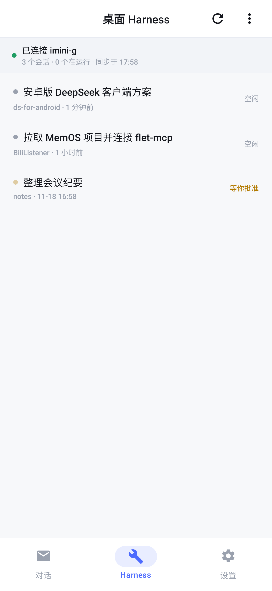

# DeepSeek 移动端（非官方）

[](https://github.com/chisteryg/deepseek-mobile/actions/workflows/android.yml)
[](LICENSE)


一个装在自己手机上的 DeepSeek 客户端，界面按 DeepSeek 官方 App / 网页端的语言实现，包含两种互不干扰的模式：

- **对话模式**：用自己的 DeepSeek API Key 直连官方 API。流式输出、思考耗时、联网搜索与引用、图片上传、文档解析上传、余额与花费、token 明细、本地会话记录。
- **Harness 模式**：连接电脑上正在运行的 [DeepSeek Harness](https://github.com/deepseek-ai)，查看会话与运行状态，实时看输出、发消息、插话、停止、处理审批、切换模型与思考档位。

> 本项目是非官方客户端，与深度求索公司无关。API Key 只保存在手机本地，不经过任何第三方服务器。

## 截图

| 对话 | 设置（余额 / 模型） | Harness | 图标 |
|---|---|---|---|
|  |  |  |  |

深色模式与其余页面见 [`screenshots/`](screenshots)。

## 功能

**对话模式**

- 流式回答；`已思考（用时 N 秒）` 可展开查看推理过程
- 联网搜索、阅读链接（服务端工具），回答带引用卡片
- 图片：相册选择 / 拍照，自动压缩到最长边 1568px 后按 image block 发送
- 文档：PDF / Word / PPT / 文本 / 表格 / 电子书，走 Files API 解析后用 `document` block 引用
- 每条回答末尾：`模型 · 本次花费 · 余额` 与 `输入 N（命中 X · 未命中 Y）· 输出 Z`
- 本地会话库，可按日期分组、重命名、删除、重新生成
- 深色 / 浅色主题，字号与间距按官方 App 的比例

**Harness 模式**

- 6 位配对码换取设备令牌，令牌持久化，重启后仍有效
- 会话列表：运行中 / 等待批准 / 空闲，工作目录与最近活动时间
- 会话详情：按「用户提问 → 助手步骤」聚合，思考折叠、工具调用摘要、Markdown 正文
- 发送、插话（steer）、停止当前回合
- 审批接管：手机最近 60 秒活跃时由手机回答，否则交回桌面端
- 模型与思考档位切换（`off / low / high / max`）
- 顶部连接状态条：已连接主机、会话数、同步时间；断线显示原因并可重试

## 架构

```
┌──────────────────────────── 手机 (Android) ────────────────────────────┐
│  Jetpack Compose UI                                                    │
│   ├─ ChatViewModel ──► DeepSeekClient ──► api.deepseek.com (SSE)       │
│   │                     └─ /files 上传解析                             │
│   └─ HarnessViewModel ─► BridgeClient ──► 桌面端 4318 (HTTP + SSE)     │
│  设置 / 余额（/user/balance）/ 本地会话（JSON 文件）/ Keystore 加密     │
└────────────────────────────────────────────────────────────────────────┘
                                   │ 同一局域网
┌──────────────────────────── 桌面 (DSH Host) ───────────────────────────┐
│  @local/dsh-mobile-bridge（Host 插件）                                  │
│   ├─ 自带 node:http 监听 0.0.0.0:4318，Bearer 设备令牌                  │
│   ├─ 会话：ctx.sessionController (list/state/follow/prompt/cancel/     │
│   │        modelCatalog/selectModel)                                   │
│   └─ 审批：approval/request 应答者瀑布（手机接管时）                    │
└────────────────────────────────────────────────────────────────────────┘
```

桌面端插件位于 [`desktop-plugin/`](desktop-plugin)，协议见 [`docs/PROTOCOL.md`](docs/PROTOCOL.md)。

## 快速开始

### 1. 构建 APK

需要 JDK 17 与 Android SDK（compileSdk 35）。

```bash
git clone https://github.com/chisteryg/deepseek-mobile.git
cd deepseek-mobile/android
./gradlew assembleDebug
# 产物：app/build/outputs/apk/debug/app-debug.apk
```

> 国内网络如果拉不到 Gradle 依赖，可把 `settings.gradle.kts` 里的阿里云镜像保留（默认已启用），或自行配置代理。Gradle Wrapper 首次运行会下载发行版。

也可以直接下载 CI 构建的产物：仓库 **Actions → Android CI → 最新一次运行 → Artifacts**。

### 2. 首次使用

安装 APK → 打开「设置」→ 填 API Key →「保存并测试」→ 回「对话」开始。

### 3. 连接桌面 Harness（可选）

1. 在桌面 DSH 的 profile 中安装插件（本地目录安装）：

   ```
   @local/dsh-mobile-bridge  ->  <仓库路径>/desktop-plugin
   ```

   或在插件管理器中以 `link:<仓库路径>/desktop-plugin` 安装。

2. 启用后桥接监听 `0.0.0.0:4318`。
3. 电脑浏览器打开 `http://127.0.0.1:4318/pair`，拿到服务地址与 6 位配对码。
4. 手机与电脑连同一 Wi-Fi，在 App 的 Harness 页填地址与配对码。
5. 首次连接 Windows 可能弹防火墙提示，允许「专用网络」。

> 插件的模型目录/切换接口需要 DSH 重启后生效（Loader 有模块代际缓存）。

## 计费说明

- 余额来自官方 `GET /user/balance`。
- 单轮花费在本地按官方价格表估算：区分缓存命中/未命中的输入价与输出价，工作日高峰（北京时区 9–12、14–18）与空闲时段半价。
- 文档上传解析按页一次性计费，**不在**单轮 token 花费里。
- 所有金额仅供参考，实际扣费以 DeepSeek 平台账单为准。

## 隐私与安全

- API Key 与桥接令牌用 Android Keystore AES-GCM 加密后存本机；设备不支持 Keystore 时降级为本地明文并标记。
- 对话内容只存在手机本地（`filesDir/conversations.json`），不上传第三方。
- Harness 模式在同一局域网内走明文 HTTP，靠配对令牌鉴权；**不要把 4318 端口暴露到公网**，需要外网访问请用 Tailscale 等隧道。
- 配对码 10 分钟有效、限次尝试；令牌可用「解除配对」随时吊销。

## 目录结构

```
android/                 Android 工程（Kotlin + Jetpack Compose）
  app/src/main/java/...    UI、对话、Harness、计费、设置
  app/src/test/...         JVM 测试与 Roborazzi 截图
desktop-plugin/          桌面端 DSH 插件（bridge.mjs 外壳 + logic.mjs 逻辑）
docs/PROTOCOL.md         桥接协议
screenshots/             离屏渲染的界面截图
assets-src/              鲸鱼娘素材与许可（含抠图结果）
```

## 开发

```bash
cd android
./gradlew testDebugUnitTest     # 17 个 JVM 测试 + 离屏截图
./gradlew assembleDebug
```

- 测试覆盖 SSE 解析、计费公式、文档 block 与 beta 头、未完成回合回放策略，以及用 Robolectric 渲染真实 `Application` 走通五个页面。
- 截图输出在 `android/app/build/screenshots/`。

## 已知限制

- Harness 只覆盖普通会话：问题回答（`ask_user_question`）、终端、文件树、计划/工作流面板仍需在电脑上操作。
- 对话模式暂不支持语音输入与 TTS。
- 单条消息最多 4 张图片 / 4 个文档，单文件上限 32 MiB（文档接口本身支持更大）。
- 仅适配手机竖屏。

## 免责声明

本项目仅用于个人学习与自用，不是 DeepSeek 官方产品，不提供任何担保。使用官方 API 产生的一切费用与合规义务由使用者自行承担；请遵守 DeepSeek 开放平台服务协议。

## License

[MIT](LICENSE) © 2026 chisteryg

鲸鱼娘形象：社区二创形象，参考 [TreapGoGo/deepseek-whale-girl](https://github.com/TreapGoGo/deepseek-whale-girl)（MIT）。图标与吉祥物由用户提供的图片抠除白底后使用，素材与许可见 [`assets-src/`](assets-src)。

---

### English

An unofficial Android client for DeepSeek with two modes: a direct-to-API chat client (streaming, reasoning, web search, image and document upload, balance and per-turn cost) and a remote control for a desktop DeepSeek Harness instance over the LAN (session list, live transcript, prompt/steer/stop, approvals, model and reasoning-effort switching). Kotlin + Jetpack Compose; the desktop side is a small DSH Host plugin under `desktop-plugin/`. MIT licensed.
